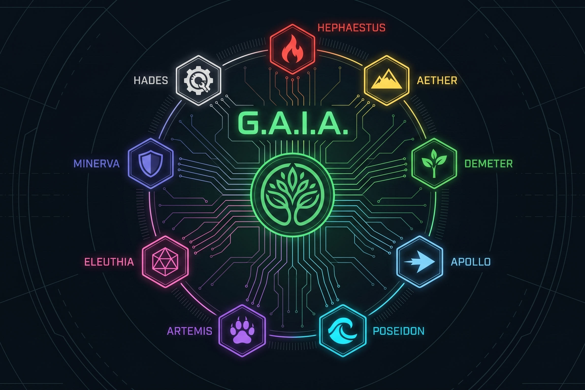
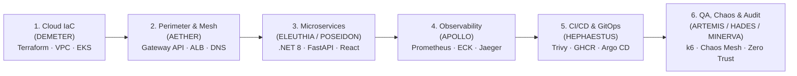
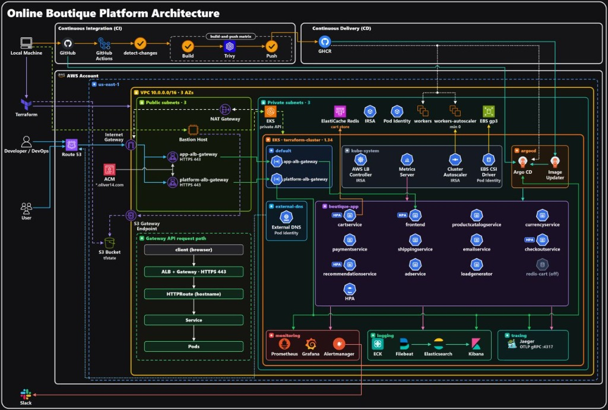

<p align="center">
  
</p>

<h1 align="center">🏛️ Cloud Architecture Blueprints</h1>
<h3 align="center">Production-Ready Cloud Native Systems, Reference Architectures & Reusable IaC/GitOps Templates</h3>

<p align="center">
  <a href="LICENSE">
    
  </a>
  <a href="https://github.com/l3onkers/cloud-architecture-blueprints/releases/tag/v1.0.1">
    
  </a>
  <a href="architectures/README.md">
    
  </a>
  <a href="architectures/01-aws-eks-online-boutique-platform/infra/terraform/">
    
  </a>
  <a href="architectures/01-aws-eks-online-boutique-platform/k8s/networking/">
    
  </a>
  <a href="architectures/01-aws-eks-online-boutique-platform/k8s/argocd/">
    
  </a>
  <a href="architectures/01-aws-eks-online-boutique-platform/docs/SECURITY_AUDIT.md">
    
  </a>
  <a href="https://github.com/l3onkers/gaia-autonomous-framework">
    
  </a>
</p>

> **An engineering portfolio of viable, end-to-end cloud architectures, polyglot microservices, GitOps delivery pipelines, and 3-pillar observability stacks—forged and verified with the [G.A.I.A. Autonomous Framework](https://github.com/l3onkers/gaia-autonomous-framework).**

---

## 🎯 Purpose & Philosophy

Most architecture repositories stop at static diagrams or isolated code snippets. **`cloud-architecture-blueprints`** bridges the gap between **system design diagrams** and **deployable production engineering** by providing:

1. **Complete 6-Layer System Implementations (`architectures/`)**: Every flagship blueprint includes modular Terraform IaC, Kubernetes Gateway API / Service Mesh routing, polyglot compilable microservices (`.NET 8`, `Python FastAPI`, `React`), 3-pillar observability (`Prometheus/Grafana/Slack`, `ECK Filebeat/ES/Kibana`, `Jaeger OTLP :4317`), GitOps (`Argo CD` + `Image Updater`), `Chaos Mesh` resilience experiments, `k6` + `Playwright` tests, and an evidence-backed **Zero Trust Security Audit**.
2. **Reusable System Design Templates (`templates/`)**: Clean skeletons for Architecture Decision Records (ADRs), Zero Trust checklists, Multi-AZ Terraform modules, and Kubernetes Gateway API + Argo CD manifests.
3. **Zero-Dependency Local Simulation & Automated Verification (`Makefile` & `scripts/portfolio-cli.py`)**: Run the 6-layer validation battery or spin up an interactive local Gateway & Storefront simulator in seconds without requiring a live AWS bill.

---

## 🗺️ The 6-Layer Architecture Methodology

Every system in this portfolio is engineered and audited across six deterministic layers:



---

## 🏛️ Featured Architecture Catalog

### 1. [Blueprint 01 — AWS EKS 1.34 Online Boutique Platform](./architectures/01-aws-eks-online-boutique-platform/README.md) *(Flagship Full-Stack System)*

<p align="center">
  <a href="./architectures/01-aws-eks-online-boutique-platform/README.md">
    
  </a>
</p>

A complete cloud-native e-commerce platform deployed in AWS (`us-east-1`) across 3 Availability Zones:

| Layer | Key Implementation Artifacts | Status |
| :--- | :--- | :---: |
| **Layer 1 (Terraform AWS)** | [`infra/terraform/`](./architectures/01-aws-eks-online-boutique-platform/infra/terraform/) — 24 HCL files (`VPC 10.0.0.0/16`, 3 Public/3 Private subnets, `S3 Gateway Endpoint`, `Bastion Host` IMDSv2, `EKS 1.34` private API, `workers` + `workers-autoscaler min 0` on `gp3`, `ElastiCache Redis 7.1`, `IRSA` + `Pod Identity`, `Route 53` + `ACM`). | ✅ **24/24 `.tf` Verified** |
| **Layer 2 (Gateway API & Add-ons)** | [`k8s/platform/`](./architectures/01-aws-eks-online-boutique-platform/k8s/platform/) & [`k8s/networking/`](./architectures/01-aws-eks-online-boutique-platform/k8s/networking/) — `AWS LB Controller`, `Metrics Server`, `Cluster Autoscaler`, `EBS CSI gp3`, `ExternalDNS`, dual-ALB `app-alb-gateway` & `platform-alb-gateway` (`HTTPS 443`) + `HTTPRoute`. | ✅ **37 K8s Objects Verified** |
| **Layer 3 (Microservices & HPA)** | [`k8s/boutique-app/`](./architectures/01-aws-eks-online-boutique-platform/k8s/boutique-app/) & [`services/`](./architectures/01-aws-eks-online-boutique-platform/services/) — All 11 Online Boutique K8s workloads + 4 `HPA` autoscalers + compilable `.NET 8` (`cartservice`), `Python FastAPI` (`productcatalogservice`, `checkoutservice`), and `React` (`frontend`). | ✅ **AST + Live E2E Verified** |
| **Layer 4 (3-Pillar Observability)** | [`k8s/observability/`](./architectures/01-aws-eks-online-boutique-platform/k8s/observability/) — `monitoring` (`Prometheus`, `Grafana`, `Alertmanager` $\to$ `Slack`), `logging` (`ECK`, `Filebeat`, `Elasticsearch`, `Kibana`), and `tracing` (`Jaeger` OTLP gRPC `:4317`). | ✅ **28 K8s Objects Verified** |
| **Layer 5 (CI Matrix & Argo CD)** | [`.github/workflows/`](./.github/workflows/) & [`k8s/argocd/`](./architectures/01-aws-eks-online-boutique-platform/k8s/argocd/) — Dynamic `detect-changes` $\to$ `Build` $\to$ `Trivy` $\to$ `GHCR` pipeline + `Argo CD` & `Argo CD Image Updater` sync waves. | ✅ **GitOps Ready** |
| **Layer 6 (QA, Chaos & Zero Trust)** | [`tests/`](./architectures/01-aws-eks-online-boutique-platform/tests/), [`k8s/chaos/`](./architectures/01-aws-eks-online-boutique-platform/k8s/chaos/), [`docs/SECURITY_AUDIT.md`](./architectures/01-aws-eks-online-boutique-platform/docs/SECURITY_AUDIT.md) & [`docs/adr/`](./architectures/01-aws-eks-online-boutique-platform/docs/adr/) — `k6`, `Playwright`, `Chaos Mesh`, 3 ADRs, and MINERVA audit (`0 Critical, 0 High`). | ✅ **100% Certified** |

### 2. [Blueprint 02 — Azure AKS Zero-Trust FinTech Ledger](./architectures/02-azure-aks-fintech-ledger-blueprint/README.md) *(Multi-Cloud Companion Starter)*
Demonstrates how the 6-layer architecture translates to **Azure AKS 1.31**, **Istio Service Mesh (strict mTLS)**, **.NET 8 CQRS**, and **Azure PostgreSQL Flexible Server with Flyway migrations**.

---

## 🚀 Quick Start — Validate, Simulate & Scaffold Locally

You can inspect, validate, and run the interactive Storefront & Gateway simulator for **Blueprint 01** directly from the repository root using `make` or `scripts/portfolio-cli.py`:

```bash
# 1. List all architecture blueprints and reusable templates in the portfolio
make list

# 2. Run the 6-layer validation battery (Terraform HCL, 104 K8s objects, Microservices, Zero Trust scan)
make validate

# 3. Execute the live End-to-End HTTP customer journey test (Catalog -> Redis Cart -> Multi-Currency Checkout)
make test-e2e

# 4. Launch the interactive Storefront UI & Gateway simulator in your browser on http://127.0.0.1:8080
make serve PORT=8080

# 5. Scaffold a brand-new 6-layer architecture blueprint from templates/
make new-blueprint NAME=03-aws-serverless-event-mesh
```

---

## 📂 Repository Structure

```text
cloud-architecture-blueprints/
├── README.md                                          # Portfolio master showcase & quickstart
├── Makefile                                           # Unified commands (list, validate, test-e2e, serve, new-blueprint)
├── AGENTS.md                                          # G.A.I.A. multi-platform agent harness routing rules
├── mcp_config.json                                    # Model Context Protocol (MCP) server configuration
├── scripts/
│   └── portfolio-cli.py                               # Portfolio automation & blueprint scaffolding CLI
├── architectures/
│   ├── README.md                                      # Blueprint comparison matrix & 6-layer standard
│   ├── 01-aws-eks-online-boutique-platform/           # Flagship AWS EKS 1.34 full-stack production blueprint
│   └── 02-azure-aks-fintech-ledger-blueprint/         # Multi-cloud Azure AKS + Istio mTLS reference starter
└── templates/
    ├── README.md                                      # Guide to reusable system design templates
    ├── architecture-blueprint/                        # Blueprint README, ADR, and Zero Trust Audit templates
    ├── terraform-skeleton/                            # Multi-AZ Terraform foundation skeleton
    └── kubernetes-gitops-skeleton/                    # Gateway API + Argo CD Image Updater starter manifests
```

---

## 📄 License & Author

- **License:** Distributed under the [MIT License](LICENSE).
- **Author:** Designed and maintained by **[l3onkers](https://github.com/l3onkers)**, powered by the **[G.A.I.A. Autonomous Platform Engineering Framework](https://github.com/l3onkers/gaia-autonomous-framework)**.
