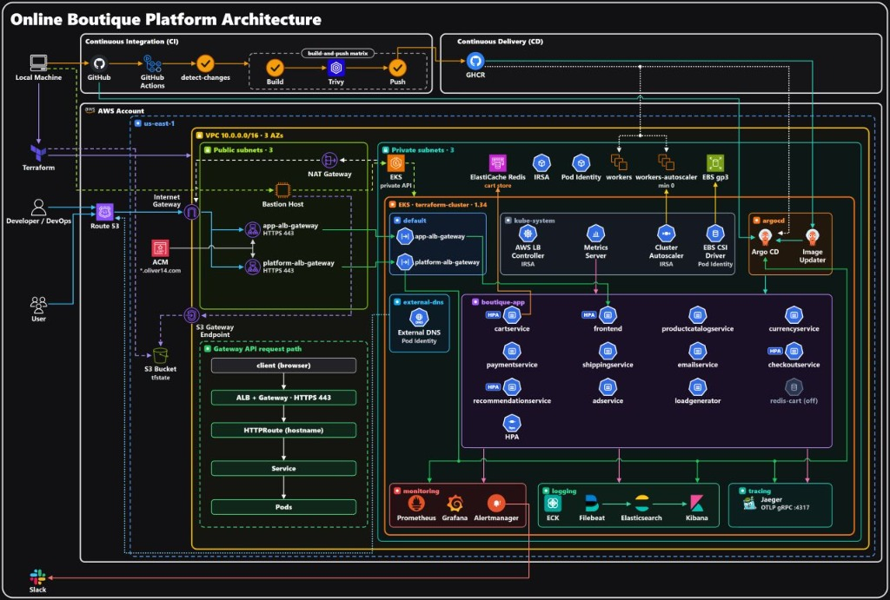
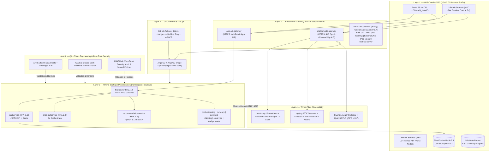
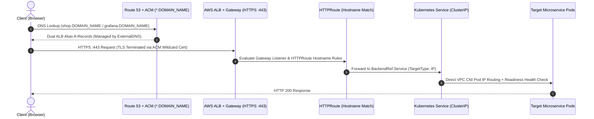

<p align="center">
  
</p>

<h1 align="center">Online Boutique AWS Cloud-Native Platform</h1>

<p align="center">
  <strong>Production-Grade Polyglot E-Commerce Platform on AWS EKS 1.34 with Kubernetes Gateway API, GitOps & Three-Pillar Observability</strong>
</p>

<p align="center">
  
  = 1.7">
  
  
  
  
  
</p>

---

## Executive Summary

The **Online Boutique AWS Cloud-Native Platform** is a full-stack reference implementation of Google's 11-microservice e-commerce architecture engineered for **AWS Elastic Kubernetes Service (`EKS 1.34`)**. Autonomously scaffolded, hardened, and verified by the **G.A.I.A. (Governance through Autonomous Infrastructure Agents) Swarm v1.1.0**, the platform demonstrates enterprise best practices across multi-AZ cloud infrastructure, **Kubernetes Gateway API** dual-ALB ingress separation, **Hybrid IAM (`IRSA` + `EKS Pod Identity`)**, continuous **Argo CD GitOps delivery**, **Three-Pillar Observability**, **Chaos Mesh resilience testing**, and **Zero Trust DevSecOps governance**.

---

## Architecture Overview

The platform is structured into **six cohesive architectural layers** mapping directly to the reference architecture diagram above:



---

### Layer 1 — AWS Cloud & VPC (`infra/terraform/`)

Provisioned deterministically via **Terraform >= 1.7** with remote state locking and KMS encryption:
- **Multi-AZ Network Topology (`VPC 10.0.0.0/16`)**: Spans 3 Availability Zones (`a`, `b`, `c`) with **3 Public Subnets** (`10.0.1.0/24` – `10.0.3.0/24`) tagged with `kubernetes.io/role/elb = 1` and **3 Private Subnets** (`10.0.101.0/24` – `10.0.103.0/24`) tagged with `kubernetes.io/role/internal-elb = 1`.
- **State, Egress & Perimeter Access**: Encrypted **S3 `tfstate` Bucket** paired with a private **S3 Gateway VPC Endpoint** (zero-cost private S3 routing), Regional **NAT Gateway** for private subnet egress, and a hardened **Bastion Host** inside the public perimeter for emergency administrative tunneling to the private EKS endpoint.
- **Amazon EKS `1.34` (`terraform-cluster`)**: Configured with a **Private API Endpoint** (`endpoint_public_access = false`, `endpoint_private_access = true`), KMS envelope encryption for Kubernetes Secrets, and full control plane audit logging (`api`, `audit`, `authenticator`, `controllerManager`, `scheduler`).
- **Managed Node Groups with `EBS gp3`**:
  - `workers`: Baseline general-purpose node group (`min 2`, `max 6`, `desired 3`) running encrypted `gp3` root volumes (`IMDSv2 http_tokens = required`).
  - `workers-autoscaler`: Elastic burst node group supporting scale-from-zero (`min 0`, `max 10`, `desired 0`) driven by the Kubernetes Cluster Autoscaler.
- **Managed Cart Persistence (`ElastiCache Redis 7.1`)**: Multi-AZ Redis replication group with automatic failover, in-transit TLS, and at-rest encryption replacing the ephemeral in-cluster `redis-cart` pod.
- **DNS & TLS Perimeter (`Route 53` + `ACM`)**: Public Route 53 Hosted Zone for `${DOMAIN_NAME}` with a DNS-validated wildcard ACM certificate (`*.${DOMAIN_NAME}`) injected into the Kubernetes Gateway API listeners.
- **Hybrid IAM Strategy (`IRSA` + `EKS Pod Identity`)**: Combines OIDC-backed **IAM Roles for Service Accounts (IRSA)** with AWS's next-generation **EKS Pod Identity Agent (`eks-pod-identity-agent`)** (documented in [ADR-0001](docs/adr/0001-eks-hybrid-irsa-and-pod-identity.md)).

---

### Layer 2 — Kubernetes Gateway API & Cluster Add-ons (`k8s/platform/`, `k8s/networking/`)

Replaces legacy single-Ingress bottlenecks with the standardized **Kubernetes Gateway API (`gateway.networking.k8s.io/v1`)** reconciled by the AWS Load Balancer Controller:



- **Cluster Add-ons (`k8s/platform/`)**:
  - **AWS Load Balancer Controller (`IRSA`)**: Reconciles `GatewayClass` (`aws-alb-gateway-class`) and provisions internet-facing ALBs with `target-type: ip`.
  - **Cluster Autoscaler (`IRSA`)**: Autoscales the `workers-autoscaler` node group (`min 0`) based on pending pod resource requests.
  - **Amazon EBS CSI Driver (`Pod Identity`)**: Provisions encrypted `gp3` PersistentVolumes (`StorageClass: ebs-gp3-sc`) for Prometheus, Elasticsearch, and Grafana.
  - **ExternalDNS (`Pod Identity`)**: Watches `Gateway` and `HTTPRoute` resources to automatically synchronize Route 53 DNS records.
  - **Metrics Server**: Supplies real-time CPU and memory metrics to HorizontalPodAutoscalers (`HPA`).
- **Dual-ALB Gateway Perimeter (`k8s/networking/gateway-api/`)** (documented in [ADR-0002](docs/adr/0002-gateway-api-dual-alb-perimeter.md)):
  - **`app-alb-gateway` (`alb.ingress.kubernetes.io/group.name: online-boutique-app`)**: Dedicated customer-facing ALB routing `shop.${DOMAIN_NAME}` and `${DOMAIN_NAME}` to `frontend:80` in `boutique`.
  - **`platform-alb-gateway` (`alb.ingress.kubernetes.io/group.name: online-boutique-platform`)**: Isolated operational control-plane ALB with explicit cross-namespace `ReferenceGrant` objects routing:
    - `argocd.${DOMAIN_NAME}` -> `argocd-server:80` (`argocd`)
    - `grafana.${DOMAIN_NAME}` -> `grafana:3000` (`monitoring`)
    - `prometheus.${DOMAIN_NAME}` -> `prometheus:9090` (`monitoring`)
    - `alertmanager.${DOMAIN_NAME}` -> `alertmanager:9093` (`monitoring`)
    - `kibana.${DOMAIN_NAME}` -> `kibana-kb-http:5601` (`logging`)
    - `jaeger.${DOMAIN_NAME}` -> `jaeger-query:16686` (`tracing`)

---

### Layer 3 — Online Boutique Microservices (`services/`, `k8s/boutique-app/`)

All 11 microservices run inside the `boutique` namespace under strict Zero Trust pod security contexts (`runAsNonRoot: true`, `readOnlyRootFilesystem: true`, `allowPrivilegeEscalation: false`, dropped `ALL` capabilities) and default-deny `NetworkPolicy` isolation:

| Microservice | Language / Stack | Scaling Strategy | Role & Persistence Binding |
| :--- | :--- | :--- | :--- |
| **`frontend`** | React 18 SPA + Go Gateway | **`HPA` (`2..10` replicas)** | Customer storefront UI and API aggregator exposed via `app-alb-gateway`. |
| **`cartservice`** | **.NET 8 Minimal API** | **`HPA` (`2..8` replicas)** | Shopping cart state persisted to **AWS ElastiCache Redis** (`redis-cart` in-cluster deployment turned **off** via `replicas: 0`). |
| **`checkoutservice`** | Go | **`HPA` (`2..6` replicas)** | Order transaction saga orchestrating cart, payment, shipping, and email notifications. |
| **`recommendationservice`** | **Python 3.12 FastAPI** | **`HPA` (`2..6` replicas)** | Product recommendation engine exposing `/healthz`, `/recommendations`, and OTLP spans. |
| **`productcatalogservice`** | Go (gRPC `:3550`) | Static (`2` replicas) | Serves product catalog metadata and search queries. |
| **`currencyservice`** | Node.js (gRPC `:7000`) | Static (`2` replicas) | Real-time currency conversion across storefront locales. |
| **`paymentservice`** | Node.js (gRPC `:50051`) | Static (`2` replicas) | Mock credit card tokenization and charge verification. |
| **`shippingservice`** | Go (gRPC `:50051`) | Static (`2` replicas) | Calculates shipping quotes and generates tracking numbers. |
| **`emailservice`** | Python (gRPC `:8080`) | Static (`2` replicas) | Sends order confirmation notifications. |
| **`adservice`** | Java (gRPC `:9555`) | Static (`2` replicas) | Contextual banner advertisement engine. |
| **`loadgenerator`** | Python Locust | Static (`1` replica) | Continuous synthetic user traffic generator. |

---

### Layer 4 — Three-Pillar Observability (`k8s/observability/`)

Full-stack telemetry across metrics, logs, and distributed traces (documented in [ADR-0003](docs/adr/0003-argocd-image-updater-and-three-pillar-observability.md)):
1. **Metrics & Alerting (`namespace: monitoring`)**:
   - **Prometheus**: Scrapes Kubernetes nodes, cAdvisor, Gateway ALBs, and microservice endpoints (`15d` retention on `ebs-gp3-sc`). Includes high-severity alert rules (`BoutiqueHighErrorRate`, `BoutiqueHighLatencyP99`, `BoutiquePodCrashLooping`, `BoutiqueCartRedisDisconnected`).
   - **Grafana**: Pre-provisioned with Prometheus, Elasticsearch, and Jaeger data sources plus golden-signal dashboards (`grafana.${DOMAIN_NAME}`).
   - **Alertmanager**: Routes critical and warning notifications directly to **Slack** (`#online-boutique-alerts`) with resolved alert tracking.
2. **Centralized Logging (`namespace: logging`)**:
   - **ECK (Elastic Cloud on Kubernetes)**: Manages a 3-node **Elasticsearch `8.12.2`** cluster backed by `ebs-gp3-sc` volumes and **Kibana `8.12.2`** (`kibana.${DOMAIN_NAME}`).
   - **Filebeat DaemonSet**: Harvests container JSON logs from `/var/log/containers/*.log` on every worker node and enriches events with Kubernetes pod/namespace metadata.
3. **Distributed Tracing (`namespace: tracing`)**:
   - **Jaeger (`jaegertracing/all-in-one:1.54`)**: Exposes the **OpenTelemetry OTLP gRPC receiver on `:4317`** (`jaeger-collector.tracing.svc.cluster.local:4317`). All 11 microservices export trace spans via `OTEL_EXPORTER_OTLP_ENDPOINT` for end-to-end request waterfall visualization on `jaeger.${DOMAIN_NAME}`.

---

### Layer 5 — CI/CD Matrix & GitOps (`/.github/workflows/`, `k8s/argocd/`)

Zero-touch continuous delivery pipeline from commit to cluster reconciliation:
1. **`detect-changes`**: Path-filtering job inspecting git diffs across `services/*`, `k8s/*`, and `infra/terraform/*` to trigger builds only for modified components.
2. **Build & Multi-Arch Packaging**: Compiles polyglot container images (`cartservice`, `recommendationservice`, `frontend`) with Docker Buildx layer caching.
3. **Trivy DevSecOps Gate**: Scans built container images and IaC manifests for `CRITICAL` and `HIGH` CVEs (`exit-code: 1` on unpatched vulnerabilities).
4. **Push to GHCR**: Publishes immutable SHA-tagged images (`ghcr.io/<org>/online-boutique/<service>:sha-<commit>`) to GitHub Container Registry.
5. **Argo CD + Argo CD Image Updater (`k8s/argocd/`)**: App-of-Apps root controller (`online-boutique-root`) continuously reconciles `platform-addons`, `gateway-api-perimeter`, `observability-stack`, and `online-boutique-app`. **Argo CD Image Updater** polls GHCR and writes immutable image digests back to Git automatically.

---

### Layer 6 — QA, Chaos Engineering & Zero Trust Security (`tests/`, `k8s/chaos/`, `docs/SECURITY_AUDIT.md`)

- **k6 Performance & SLO Load Testing (`tests/k6/load-test.js`)**: Simulates concurrent user journeys across homepage browsing, product catalog views, cart updates, and checkout with strict SLO thresholds (`http_req_duration p(95) < 500ms`, `http_req_failed < 1%`).
- **Playwright End-to-End UI Suite (`tests/e2e/`)**: Automated headless Chromium browser verification of storefront rendering, cart drawer interactions, currency switching, and order confirmation flows.
- **Chaos Mesh Resilience Experiments (`k8s/chaos/`)**:
  - `pod-kill-cartservice.yaml`: Periodically terminates `cartservice` pods to verify zero-data-loss session persistence in AWS ElastiCache Redis and rapid HPA recovery.
  - `network-delay-checkout.yaml`: Injects `250ms` latency (`±50ms` jitter) into `checkoutservice` to validate Jaeger OTLP latency attribution and circuit-breaker resilience.
- **MINERVA Zero Trust Security Audit (`docs/SECURITY_AUDIT.md`)**: Comprehensive static analysis and threat model verification covering IAM least privilege, KMS encryption, Kubernetes Pod Security Standards (`Restricted`), default-deny `NetworkPolicy`, and secret hygiene.

---

## G.A.I.A. Autonomous Swarm Attribution

This platform was architected, scaffolded, and verified through coordinated multi-agent execution across all **10 G.A.I.A. specialized subroutines** and **3 newly forged capability skills**:

| Agent / Forged Skill | Domain Specialty | Platform Deliverables & Artifacts |
| :--- | :--- | :--- |
| **GAIA** (`gaia`) | Central Orchestrator | Multi-agent dependency graph orchestration, cross-layer contract alignment, and root validation suite (`tests/validate/run-all.sh`). |
| **DEMETER** (`demeter`) | IaC & Cloud Provisioning | AWS VPC (`10.0.0.0/16`, 3 AZs), EKS `1.34` private cluster, `gp3` Node Groups, ElastiCache Redis 7.1, Route 53 + ACM, and Hybrid IAM (`infra/terraform/`). |
| **AETHER** (`aether`) | Networking & Service Mesh | Dual-ALB Kubernetes Gateway API perimeter (`app-alb-gateway`, `platform-alb-gateway`), `HTTPRoute` definitions, and cross-namespace `ReferenceGrant` policies (`k8s/networking/`). |
| **ELEUTHIA** (`eleuthia`) | Application Scaffolding | Polyglot source scaffolds for `.NET 8` (`services/cartservice/`), `Python 3.12 FastAPI` (`services/recommendationservice/`), and `React 18` (`services/frontend/`), plus all 11 Kubernetes manifests and 4 HPAs (`k8s/boutique-app/`). |
| **POSEIDON** (`poseidon`) | Data & Storage | Local parity `docker-compose.yml` with Redis 7.2 persistence, healthchecks, and ElastiCache Redis connection bindings (`k8s/boutique-app/configmap-env.yaml`). |
| **APOLLO** (`apollo`) | Knowledge & Observability | Three-pillar observability stack (`k8s/observability/`), portfolio root `README.md`, and Architectural Decision Records (`docs/adr/0001`–`0003`). |
| **HEPHAESTUS** (`hephaestus`) | Forge & CI/CD | Change-detection GitHub Actions matrix (`.github/workflows/ci-cd-matrix.yml`), Argo CD App-of-Apps, and Argo CD Image Updater manifests (`k8s/argocd/`). |
| **MINERVA** (`minerva`) | DevSecOps & Security | Zero Trust Pod Security enforcement, default-deny `NetworkPolicy`, Trivy gate configuration, and evidence-backed audit report (`docs/SECURITY_AUDIT.md`). |
| **ARTEMIS** (`artemis`) | QA & Automated Testing | k6 load-testing script (`tests/k6/load-test.js`) and Playwright E2E storefront test suite (`tests/e2e/`). |
| **HADES** (`hades`) | Chaos Engineering | Chaos Mesh `PodChaos` (`pod-kill-cartservice.yaml`) and `NetworkChaos` (`network-delay-checkout.yaml`) resilience experiments (`k8s/chaos/`). |
| **`aether-k8s-gateway-api`** | *Newly Forged Skill* | Reusable skill governing Kubernetes Gateway API (`GatewayClass`, dual `Gateway`, `HTTPRoute`, `ReferenceGrant`) backed by AWS ALB and ExternalDNS. |
| **`hephaestus-argocd-gitops`** | *Newly Forged Skill* | Reusable skill governing monorepo `detect-changes` CI matrices, Trivy image scanning, GHCR publishing, and Argo CD + Image Updater GitOps synchronization. |
| **`apollo-observability-stack`** | *Newly Forged Skill* | Reusable skill governing 3-pillar Kubernetes telemetry: Prometheus/Grafana/Alertmanager (Slack), ECK (Filebeat/Elasticsearch/Kibana), and Jaeger OTLP gRPC (`:4317`). |

---

## Repository Structure

```text
online-boutique-aws-platform/
├── .github/workflows/
│   └── ci-cd-matrix.yml              # Change-detecting CI/CD -> Build -> Trivy -> GHCR -> GitOps
├── docs/
│   ├── SECURITY_AUDIT.md             # MINERVA Zero Trust DevSecOps Audit Report
│   ├── adr/                          # Architecture Decision Records (0001 - 0003)
│   └── assets/
│       └── online-boutique-architecture.jpg
├── infra/terraform/                  # Layer 1: VPC, EKS 1.34, ElastiCache Redis, Route 53, ACM, Hybrid IAM
├── k8s/
│   ├── platform/                     # Layer 2: AWS LB Controller, Autoscaler, EBS CSI, ExternalDNS, Metrics Server
│   ├── networking/gateway-api/       # Layer 2: GatewayClass, Dual ALB Gateways, HTTPRoutes, ReferenceGrants
│   ├── boutique-app/                 # Layer 3: 11 Microservices, 4 HPAs, ElastiCache ConfigMap, NetworkPolicy
│   ├── observability/                # Layer 4: Prometheus, Grafana, Alertmanager, ECK/Filebeat, Jaeger OTLP
│   ├── argocd/                       # Layer 5: App-of-Apps Root + Argo CD Image Updater
│   └── chaos/                        # Layer 6: Chaos Mesh PodKill & NetworkDelay experiments
├── services/
│   ├── cartservice/                  # .NET 8 Minimal API + Redis Cart Store
│   ├── recommendationservice/        # Python 3.12 FastAPI Recommendation Service
│   └── frontend/                     # React 18 Storefront SPA + Nginx Gateway
├── tests/
│   ├── e2e/                          # Playwright E2E UI Test Suite
│   ├── k6/                           # k6 Performance & SLO Load Testing Script
│   └── validate/run-all.sh           # Offline Structural, Terraform, Kubernetes & Security Validation Suite
└── docker-compose.yml                # Local Full-Stack Development & Parity Environment
```

---

## Step-by-Step Deployment & Local Testing Guide

### 1. Local Development & Offline Validation

Run the entire polyglot core stack (`frontend`, `cartservice`, `recommendationservice`, `redis-cart`, and `jaeger` OTLP collector) locally using Docker Compose:

```bash
# 1. Start the local stack with hot-reload & healthchecks
docker compose up --build -d

# 2. Verify service endpoints
curl -f http://localhost:8080/healthz                  # Frontend Storefront (http://localhost:8080)
curl -f http://localhost:7070/healthz                  # .NET 8 Cart Service API
curl -f http://localhost:8081/healthz                  # Python FastAPI Recommendation Service
open http://localhost:16686                            # Jaeger Distributed Tracing UI
```

Execute the deterministic offline verification harness across Terraform, Kubernetes manifests, observability wiring, and security gates:

```bash
bash tests/validate/run-all.sh
```

Run automated quality and load tests against the local or staging environment:

```bash
# Run Playwright E2E tests
cd tests/e2e && npm install && BASE_URL=http://localhost:8080 npx playwright test

# Run k6 load tests
k6 run -e BASE_URL=http://localhost:8080 tests/k6/load-test.js
```

---

### 2. Production AWS Deployment (`Terraform` + `Argo CD`)

#### Prerequisites
- AWS CLI v2 authenticated with an IAM principal capable of provisioning VPC, EKS, ElastiCache, IAM, Route 53, and ACM.
- `terraform >= 1.7`, `kubectl >= 1.30`, and an existing Route 53 Public Hosted Zone for your domain.

#### Step 1: Provision AWS Infrastructure (`Layer 1`)

```bash
cd infra/terraform

# Initialize Terraform providers and remote S3 backend
terraform init

# Validate and review the execution plan
terraform plan \
  -var="domain_name=boutique.example.com" \
  -var="environment=prod" \
  -out=tfplan

# Apply VPC, EKS 1.34, ElastiCache Redis, ACM, Route 53, and Hybrid IAM
terraform apply tfplan
```

#### Step 2: Configure Cluster Access & Inject Dynamic Endpoints

```bash
# Update kubeconfig via private VPN or Bastion tunnel
aws eks update-kubeconfig --region us-east-1 --name terraform-cluster

# Export Terraform outputs for cluster add-ons and Gateway API listeners
export DOMAIN_NAME="boutique.example.com"
export ACM_CERTIFICATE_ARN=$(terraform -chdir=infra/terraform output -raw acm_certificate_arn)
export ELASTICACHE_REDIS_ENDPOINT=$(terraform -chdir=infra/terraform output -raw elasticache_redis_endpoint)
```

#### Step 3: Bootstrap Platform Add-ons & Argo CD GitOps (`Layers 2–5`)

```bash
# 1. Apply core platform add-ons (AWS LB Controller, EBS CSI, ExternalDNS, Autoscaler, Metrics Server)
kubectl apply -f k8s/platform/

# 2. Bootstrap Argo CD and the App-of-Apps root manifest
kubectl create namespace argocd --dry-run=client -o yaml | kubectl apply -f -
kubectl apply -f k8s/argocd/

# 3. Verify Dual-ALB Gateway API provisioning and HTTPRoute bindings
kubectl get gatewayclass,gateway,httproute -A
```

Once ExternalDNS synchronizes the dual ALBs with Route 53, access your live endpoints:
- **Customer Storefront (`app-alb-gateway`)**: `https://shop.${DOMAIN_NAME}`
- **Argo CD GitOps UI (`platform-alb-gateway`)**: `https://argocd.${DOMAIN_NAME}`
- **Grafana Dashboards (`platform-alb-gateway`)**: `https://grafana.${DOMAIN_NAME}`
- **Prometheus & Alertmanager (`platform-alb-gateway`)**: `https://prometheus.${DOMAIN_NAME}` | `https://alertmanager.${DOMAIN_NAME}`
- **Kibana Logs (`platform-alb-gateway`)**: `https://kibana.${DOMAIN_NAME}`
- **Jaeger Distributed Tracing (`platform-alb-gateway`)**: `https://jaeger.${DOMAIN_NAME}`

---

## Architecture Decision Records (ADRs)

| ADR | Title | Status | Summary |
| :--- | :--- | :--- | :--- |
| **[ADR-0001](docs/adr/0001-eks-hybrid-irsa-and-pod-identity.md)** | Hybrid EKS Workload Identity with IRSA and EKS Pod Identity | Accepted | Uses **IRSA** for OIDC-coupled controllers (`AWS LB Controller`, `Cluster Autoscaler`) and **EKS Pod Identity** for portable add-ons (`EBS CSI Driver`, `ExternalDNS`). |
| **[ADR-0002](docs/adr/0002-gateway-api-dual-alb-perimeter.md)** | Kubernetes Gateway API with Dual-ALB Perimeter Separation | Accepted | Adopts Kubernetes Gateway API (`v1`) with two isolated ALBs (`app-alb-gateway` vs. `platform-alb-gateway`) and explicit `ReferenceGrant` policies. |
| **[ADR-0003](docs/adr/0003-argocd-image-updater-and-three-pillar-observability.md)** | GitOps Continuous Delivery with Argo CD Image Updater and Three-Pillar Observability | Accepted | Establishes automated digest write-back via Argo CD Image Updater and unifies Prometheus/Grafana/Alertmanager, ECK/Filebeat, and Jaeger OTLP gRPC (`:4317`). |
