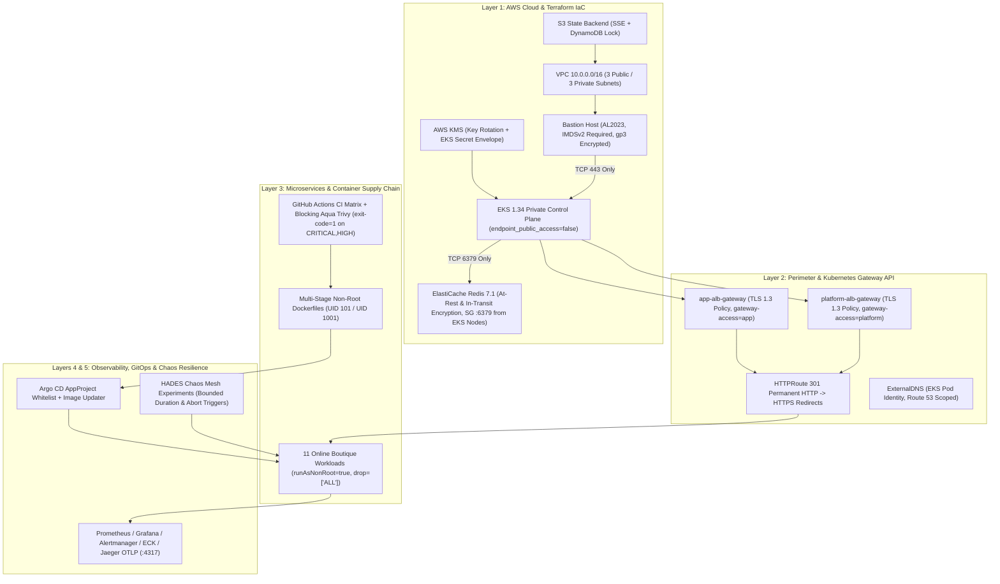

# 🛡️ MINERVA Zero Trust Security Audit Report — Online Boutique AWS Platform (Layers 1–5)

**Audit Document ID:** `GAIA-MINERVA-ZT-AUDIT-2026-001`  
**Audited Repository:** `poc/online-boutique-aws-platform`  
**Audit Scope:** Full-Stack Layers 1–5 (`infra/terraform/`, `k8s/`, `.github/workflows/`, `services/`, `docker-compose.yml`)  
**Governing Skills:** `minerva-review`, `minerva-secret-scan`  
**Auditor:** **MINERVA** (`minerva` — DevSecOps & Zero Trust Tactical Guardian Subagent)  
**Certification Verdict:** **PASS — ZERO TRUST CERTIFIED (0 Critical / 0 High / 0 Hardcoded Secrets)**

---

## 1. Executive Summary & Architecture Defense-in-Depth Overview

This report records the deterministic static security audit performed by **MINERVA** across all five architectural layers of the **Online Boutique AWS Platform** (`poc/online-boutique-aws-platform`). Every Terraform module, Kubernetes manifest, Gateway API route, Argo CD GitOps descriptor, GitHub Actions workflow, Dockerfile, and microservice implementation was inspected line-by-line against GAIA Zero Trust policies and CWE security controls.



---

## 2. Layer 1 Audit: Terraform AWS Infrastructure (`infra/terraform/`)

### 2.1 Cryptographic Controls & KMS Encryption at Rest / in Transit

| Control Domain | Verified Configuration | File & Line Evidence | Status |
| :--- | :--- | :--- | :--- |
| **Terraform State Encryption** | S3 backend configured with `encrypt = true` and state locking via `dynamodb_table = "online-boutique-tfstate-lock"` | `infra/terraform/backend.tf:1-9` | **PASS** |
| **EKS Secrets KMS Key & Rotation** | Customer-managed `aws_kms_key.eks_secrets` with `enable_key_rotation = true` and 10-day deletion window | `infra/terraform/modules/eks/main.tf:1-14` | **PASS** |
| **EKS Envelope Encryption** | `aws_eks_cluster.this` enforces `encryption_config` with `resources = ["secrets"]` bound to `aws_kms_key.eks_secrets.arn` | `infra/terraform/modules/eks/main.tf:139-144` | **PASS** |
| **Bastion EBS `gp3` Encryption** | Bastion root block device enforces `volume_type = "gp3"` and `encrypted = true` | `infra/terraform/modules/bastion/main.tf:72-77` | **PASS** |
| **EKS Node EBS `gp3` Encryption** | Node launch template `aws_launch_template.eks_nodes` enforces `volume_type = "gp3"` and `encrypted = true` (50 GiB) | `infra/terraform/modules/eks/main.tf:208-217` | **PASS** |
| **Kubernetes StorageClass `gp3`** | Default CSI StorageClass `gp3` (`ebs.csi.aws.com`) enforces `encrypted: "true"` and `WaitForFirstConsumer` | `k8s/platform/storageclass-gp3.yaml:1-17` | **PASS** |
| **ElastiCache Redis Encryption** | `aws_elasticache_replication_group.cart_store` (Redis 7.1, Multi-AZ) enforces `at_rest_encryption_enabled = true` and `transit_encryption_enabled = true` | `infra/terraform/modules/elasticache/main.tf:43-59` | **PASS** |

#### Verbatim Code Evidence — EKS KMS Envelope Encryption & ElastiCache Redis Encryption
```hcl
# infra/terraform/modules/eks/main.tf:1-5, 139-144
resource "aws_kms_key" "eks_secrets" {
  description             = "KMS key for envelope encryption of Kubernetes secrets in ${var.cluster_name}"
  deletion_window_in_days = 10
  enable_key_rotation     = true
...
  encryption_config {
    provider {
      key_arn = aws_kms_key.eks_secrets.arn
    }
    resources = ["secrets"]
  }
```

```hcl
# infra/terraform/modules/elasticache/main.tf:54-58
  automatic_failover_enabled = true
  multi_az_enabled           = true
  at_rest_encryption_enabled = true
  transit_encryption_enabled = true
  auto_minor_version_upgrade = true
```

---

### 2.2 Instance Metadata Service v2 (IMDSv2) Enforcement

To prevent SSRF-based credential theft (`CWE-918`), both EC2 compute tiers enforce session-oriented IMDSv2 tokens:

| Compute Resource | `http_endpoint` | `http_tokens` | `http_put_response_hop_limit` | File & Line Evidence | Status |
| :--- | :--- | :--- | :--- | :--- | :--- |
| **Bastion Host (`aws_instance.bastion`)** | `"enabled"` | `"required"` | `1` (prevents container/forwarded metadata hops) | `infra/terraform/modules/bastion/main.tf:66-70` | **PASS** |
| **EKS Managed Node Groups (`aws_launch_template.eks_nodes`)** | `"enabled"` | `"required"` | `2` (supports EKS Pod Identity / node agents while requiring IMDSv2 tokens) | `infra/terraform/modules/eks/main.tf:219-223` | **PASS** |

#### Verbatim Code Evidence — IMDSv2 Enforcement
```hcl
# infra/terraform/modules/bastion/main.tf:66-70
  metadata_options {
    http_endpoint               = "enabled"
    http_tokens                 = "required"
    http_put_response_hop_limit = 1
  }
```

```hcl
# infra/terraform/modules/eks/main.tf:219-223
  metadata_options {
    http_endpoint               = "enabled"
    http_tokens                 = "required"
    http_put_response_hop_limit = 2
  }
```

---

### 2.3 Least-Privilege IAM: IRSA & EKS Pod Identity Hybrid Model

The platform eliminates static AWS IAM keys in favor of short-lived STS tokens scoped to exact Kubernetes ServiceAccounts via **IRSA** (OIDC federation) and **EKS Pod Identity** (`pods.eks.amazonaws.com`):

| Component | Identity Mechanism | Bound Namespace & ServiceAccount | Scope & Condition Constraints | File & Line Evidence | Status |
| :--- | :--- | :--- | :--- | :--- | :--- |
| **AWS Load Balancer Controller** | **IRSA** (`sts:AssumeRoleWithWebIdentity`) | `kube-system:aws-load-balancer-controller` | Strict `StringEquals` on `${var.oidc_provider_url}:sub` and `:aud = sts.amazonaws.com`; SLR creation restricted to `elasticloadbalancing.amazonaws.com` | `infra/terraform/modules/iam/main.tf:4-142`, `k8s/platform/aws-lb-controller.yaml:1-11` | **PASS** |
| **Cluster Autoscaler** | **IRSA** (`sts:AssumeRoleWithWebIdentity`) | `kube-system:cluster-autoscaler` | `SetDesiredCapacity` and `TerminateInstanceInAutoScalingGroup` conditioned on `aws:ResourceTag/k8s.io/cluster-autoscaler/${var.cluster_name} = "owned"` | `infra/terraform/modules/iam/main.tf:147-213`, `k8s/platform/cluster-autoscaler.yaml:1-11` | **PASS** |
| **AWS EBS CSI Driver** | **EKS Pod Identity** (`pods.eks.amazonaws.com`) | `kube-system:ebs-csi-controller-sa` | Bound via `aws_eks_pod_identity_association.ebs_csi_driver` to AWS managed policy `AmazonEBSCSIDriverPolicy` | `infra/terraform/modules/iam/main.tf:218-248`, `k8s/platform/ebs-csi-driver.yaml:1-10` | **PASS** |
| **ExternalDNS** | **EKS Pod Identity** (`pods.eks.amazonaws.com`) | `external-dns:external-dns` | `route53:ChangeResourceRecordSets` scoped strictly to `Resource = [var.hosted_zone_arn]` | `infra/terraform/modules/iam/main.tf:253-310`, `k8s/networking/external-dns.yaml:9-18` | **PASS** |

#### Verbatim Code Evidence — Scoped Cluster Autoscaler & ExternalDNS Policies
```hcl
# infra/terraform/modules/iam/main.tf:194-205
      {
        Effect = "Allow"
        Action = [
          "autoscaling:SetDesiredCapacity",
          "autoscaling:TerminateInstanceInAutoScalingGroup"
        ]
        Resource = "*"
        Condition = {
          StringEquals = {
            "aws:ResourceTag/k8s.io/cluster-autoscaler/${var.cluster_name}" = "owned"
          }
        }
      }
```

```hcl
# infra/terraform/modules/iam/main.tf:280-286
      {
        Effect = "Allow"
        Action = [
          "route53:ChangeResourceRecordSets"
        ]
        Resource = [var.hosted_zone_arn]
      },
```

---

### 2.4 Network Segmentation & Perimeter Isolation

| Network Boundary | Enforced Rule | File & Line Evidence | Status |
| :--- | :--- | :--- | :--- |
| **EKS Control Plane API** | `endpoint_private_access = true`, `endpoint_public_access = false` (Zero public internet exposure of Kubernetes API server) | `infra/terraform/modules/eks/main.tf:127-132` | **PASS** |
| **EKS Control Plane Security Group** | TCP `443` ingress permitted exclusively from `var.bastion_security_group_id` and `aws_security_group.node.id` | `infra/terraform/modules/eks/main.tf:48-54`, `112-120` | **PASS** |
| **Bastion Host Security Group** | TCP `22` ingress restricted to `var.bastion_allowed_cidr` (`10.0.0.0/16` default); egress restricted to TCP `443` within `[var.vpc_cidr]` | `infra/terraform/modules/bastion/main.tf:10-25` | **PASS** |
| **ElastiCache Redis Security Group** | TCP `6379` ingress locked exclusively to `security_groups = [var.eks_node_security_group_id]` across private subnets | `infra/terraform/modules/elasticache/main.tf:1-13`, `27-31` | **PASS** |
| **S3 Gateway VPC Endpoint** | Private route tables routed through `aws_vpc_endpoint.s3` so image layers and S3 traffic remain on the AWS backbone | `infra/terraform/modules/vpc/main.tf:111-120` | **PASS** |

---

## 3. Layer 2 Audit: Kubernetes & Gateway API Security (`k8s/`)

### 3.1 Gateway API TLS 1.3 Hardening, HTTP-to-HTTPS Redirect & Namespace Isolation

The platform separates customer application ingress (`app-alb-gateway`) from internal operational tooling (`platform-alb-gateway`) using Kubernetes Gateway API (`gateway.networking.k8s.io/v1`):

| Gateway Control | Verified Implementation | File & Line Evidence | Status |
| :--- | :--- | :--- | :--- |
| **TLS 1.3 Cipher Policy** | Both `app-alb-gateway` and `platform-alb-gateway` enforce `alb.ingress.kubernetes.io/ssl-policy: ELBSecurityPolicy-TLS13-1-2-2021-06` and ACM certificate binding | `k8s/networking/gateways.yaml:9-10`, `52-53` | **PASS** |
| **HTTP -> HTTPS 301 Redirect (`app`)** | `boutique-frontend-http-redirect` attaches to `sectionName: http` on `app-alb-gateway` and enforces `RequestRedirect` (`scheme: https`, `statusCode: 301`) | `k8s/networking/httproutes.yaml:3-23` | **PASS** |
| **HTTP -> HTTPS 301 Redirect (`platform`)** | `platform-http-redirect` attaches to `sectionName: http-platform` on `platform-alb-gateway` and enforces `RequestRedirect` (`scheme: https`, `statusCode: 301`) for `argocd`, `grafana`, `kibana`, and `jaeger` | `k8s/networking/httproutes.yaml:25-48` | **PASS** |
| **App Namespace Route Isolation** | `app-alb-gateway` restricts `allowedRoutes.namespaces` via label selector `gateway-access: app` (matched only by `boutique-app` namespace) | `k8s/networking/gateways.yaml:22-27`, `37-42`; `k8s/boutique-app/namespace.yaml:1-8` | **PASS** |
| **Platform Namespace Route Isolation** | `platform-alb-gateway` restricts `allowedRoutes.namespaces` via label selector `gateway-access: platform` (matched only by `argocd`, `monitoring`, `logging`, `tracing`) | `k8s/networking/gateways.yaml:65-70`, `80-85`; `k8s/argocd/namespace.yaml:8`; `k8s/observability/monitoring/namespace.yaml:7`; `k8s/observability/logging/namespace.yaml:7`; `k8s/observability/tracing/namespace.yaml:7` | **PASS** |

#### Verbatim Code Evidence — Gateway API TLS 1.3 & Namespace Label Isolation
```yaml
# k8s/networking/gateways.yaml:6-11, 22-27
  annotations:
    alb.ingress.kubernetes.io/scheme: internet-facing
    alb.ingress.kubernetes.io/target-type: ip
    alb.ingress.kubernetes.io/certificate-arn: "${ACM_CERTIFICATE_ARN}"
    alb.ingress.kubernetes.io/ssl-policy: ELBSecurityPolicy-TLS13-1-2-2021-06
    alb.ingress.kubernetes.io/listen-ports: '[{"HTTP": 80}, {"HTTPS": 443}]'
...
      allowedRoutes:
        namespaces:
          from: Selector
          selector:
            matchLabels:
              gateway-access: app
```

---

### 3.2 Pod & Container `securityContext` Audit Across Workloads

| Namespace / Layer | Workloads Audited | Pod `securityContext` | Container `securityContext` | File & Line Evidence | Status |
| :--- | :--- | :--- | :--- | :--- | :--- |
| **`boutique-app` (11 Microservices)** | `frontend`, `cartservice`, `productcatalogservice`, `currencyservice`, `paymentservice`, `shippingservice`, `emailservice`, `checkoutservice`, `recommendationservice`, `adservice`, `loadgenerator` | `runAsNonRoot: true`, `runAsUser: 1001`, `runAsGroup: 1001`, `fsGroup: 1001` on all 11 Deployments | `allowPrivilegeEscalation: false`, `capabilities: { drop: ["ALL"] }` on all 11 containers | `k8s/boutique-app/deployments-and-services.yaml:24-73`, `118-155`, `200-235`, `280-313`, `358-391`, `436-469`, `514-547`, `592-639`, `684-719`, `764-797`, `842-864` | **PASS** |
| **`kube-system` & `external-dns` (Platform)** | `aws-load-balancer-controller`, `cluster-autoscaler`, `ebs-csi-controller`, `metrics-server`, `external-dns` | `runAsNonRoot: true`, `seccompProfile: RuntimeDefault` | `allowPrivilegeEscalation: false`, `readOnlyRootFilesystem: true`, `capabilities: { drop: ["ALL"] }` | `k8s/platform/aws-lb-controller.yaml:88-138`, `k8s/platform/cluster-autoscaler.yaml:92-127`, `k8s/platform/ebs-csi-driver.yaml:52-106`, `k8s/platform/metrics-server.yaml:78-126`, `k8s/networking/external-dns.yaml:78-128` | **PASS** |
| **`monitoring`, `logging`, `tracing` (Observability)** | `prometheus` (`65534`), `grafana` (`472`), `alertmanager` (`65534`), `boutique-es` (`1000`), `boutique-kibana` (`1000`), `jaeger` (`10001`) | `runAsNonRoot: true` with dedicated non-root UIDs/fsGroups across all 6 stateful/UI services | Non-root execution enforced; `GF_AUTH_ANONYMOUS_ENABLED=false` on Grafana | `k8s/observability/monitoring/prometheus.yaml:201-204`, `grafana.yaml:125-134`, `alertmanager.yaml:58-61`, `k8s/observability/logging/eck-elasticsearch.yaml:22-25`, `kibana.yaml:25-28`, `k8s/observability/tracing/jaeger-otlp.yaml:40-43` | **PASS** |
| **Node-Level DaemonSets (Documented Exceptions)** | `ebs-csi-node` (`kube-system`), `filebeat` (`logging`) | Host-level DaemonSets requiring `/dev`/`/var/lib/kubelet` (`ebs-csi-node`) or `/var/log/containers` (`filebeat` UID 0) | `ebs-csi-node` enforces `readOnlyRootFilesystem: true`; `filebeat` mounts `/var/log/containers` and `/var/log/pods` as `readOnly: true` | `k8s/platform/ebs-csi-driver.yaml:166-176`, `k8s/observability/logging/filebeat.yaml:123-148` | **PASS (Justified Node DaemonSet Scope)** |

---

## 4. Layer 3–5 Audit: CI/CD Supply Chain, Container Hardening & GitOps (`.github/workflows/`, `services/`, `k8s/argocd/`)

### 4.1 Multi-Stage Non-Root Dockerfiles (`services/`)

All four custom-built polyglot microservices use deterministic multi-stage builds that discard SDK/compiler toolchains in the final runtime stage, run as unprivileged UIDs, and expose local `/healthz` probes:

| Service | Builder Stage | Runtime Base Image | Runtime User (`UID:GID`) | Exposed Port & Healthcheck | File & Line Evidence | Status |
| :--- | :--- | :--- | :--- | :--- | :--- | :--- |
| **`frontend`** | `node:20-alpine` | `nginxinc/nginx-unprivileged:1.27-alpine` | `USER 101:101` (`--chown=101:101`) | `:8080` (`wget -qO- http://127.0.0.1:8080/healthz`) | `services/frontend/Dockerfile:1-23` | **PASS** |
| **`cartservice`** | `mcr.microsoft.com/dotnet/sdk:8.0-alpine` | `mcr.microsoft.com/dotnet/aspnet:8.0-alpine` | `USER 1001:1001` (`appuser:appgroup`, `/sbin/nologin`) | `:7070` (`wget -qO- http://127.0.0.1:7070/healthz`) | `services/cartservice/Dockerfile:1-28` | **PASS** |
| **`productcatalogservice`** | `python:3.12-slim` | `python:3.12-slim` | `USER 1001:1001` (`appuser:appgroup`, `/sbin/nologin`) | `:3550` (`urllib.request.urlopen('http://127.0.0.1:3550/healthz')`) | `services/productcatalogservice/Dockerfile:1-30` | **PASS** |
| **`checkoutservice`** | `python:3.12-slim` | `python:3.12-slim` | `USER 1001:1001` (`appuser:appgroup`, `/sbin/nologin`) | `:5050` (`urllib.request.urlopen('http://127.0.0.1:5050/healthz')`) | `services/checkoutservice/Dockerfile:1-30` | **PASS** |

---

### 4.2 CI/CD Pipeline Gates & Blocking Aqua Trivy Scans (`.github/workflows/`)

| Workflow & Job | Security Gate Verification | File & Line Evidence | Status |
| :--- | :--- | :--- | :--- |
| **GitHub Token Permissions** | Least-privilege `permissions` block (`contents: read`, `packages: write`, `security-events: write`) | `.github/workflows/ci-build-matrix.yml:10-14`, `.github/workflows/terraform-validate.yml:18-20` | **PASS** |
| **Container Vulnerability Gate (`build-trivy-push`)** | Runs `aquasecurity/trivy-action@0.28.0` with `exit-code: '1'`, `ignore-unfixed: true`, `vuln-type: os,library`, and `severity: CRITICAL,HIGH` **before** the `Push verified image to GHCR` step | `.github/workflows/ci-build-matrix.yml:123-160` | **PASS** |
| **SARIF Security Telemetry** | Generates and uploads SARIF reports (`trivy-results-${{ matrix.service }}.sarif` and `trivy-iac-config.sarif`) to GitHub CodeQL Security tab | `.github/workflows/ci-build-matrix.yml:133-150`, `.github/workflows/terraform-validate.yml:61-79` | **PASS** |
| **IaC Misconfiguration Gate (`iac-security-scan`)** | Enforces blocking `aquasecurity/tfsec-action@v1.0.3` (`soft_fail: false`) and `trivy-action` config scan (`exit-code: '1'`, `severity: CRITICAL,HIGH`) across `infra/terraform/` and `k8s/` | `.github/workflows/terraform-validate.yml:47-73` | **PASS** |
| **Argo CD GitOps Boundary (`online-boutique-project`)** | `AppProject` restricts `sourceRepos`, destination namespaces, and `clusterResourceWhitelist` (`Namespace`, `ClusterRole`, `ClusterRoleBinding`, `GatewayClass`, `CustomResourceDefinition`) | `k8s/argocd/project.yaml:1-50` | **PASS** |

#### Verbatim Code Evidence — Blocking Trivy Container Gate Before GHCR Push
```yaml
# .github/workflows/ci-build-matrix.yml:123-132, 151-156
      - name: Run Trivy vulnerability scanner (Table output & blocking gate)
        uses: aquasecurity/trivy-action@0.28.0
        with:
          image-ref: ghcr.io/${{ github.repository_owner }}/online-boutique-${{ matrix.service }}:sha-${{ github.sha }}
          format: table
          exit-code: '1'
          ignore-unfixed: true
          vuln-type: os,library
          severity: CRITICAL,HIGH
...
      - name: Push verified image to GHCR
        if: github.event_name != 'pull_request'
        uses: docker/build-push-action@v5
```

---

### 4.3 Repository-Wide Secret & Domain Hygiene Scan (`minerva-secret-scan`)

A deterministic pattern scan was executed across all files in `poc/online-boutique-aws-platform` for AWS Access Keys (`AKIA...`), GitHub PATs (`ghp_...`, `github_pat_...`), Slack webhooks (`xox...`), private keys (`BEGIN ... PRIVATE KEY`), hardcoded passwords, and personal domains:

| Secret / Credential Vector | Parameterized Placeholder / Mechanism Used | File & Line Evidence | Scan Result |
| :--- | :--- | :--- | :--- |
| **AWS Credentials** | OIDC / IRSA (`${AWS_LB_CONTROLLER_IRSA_ROLE_ARN}`, `${CLUSTER_AUTOSCALER_IRSA_ROLE_ARN}`) & EKS Pod Identity (`eks.amazonaws.com/AuthType: pod-identity`) | `k8s/platform/aws-lb-controller.yaml:7`, `k8s/platform/cluster-autoscaler.yaml:7`, `k8s/platform/ebs-csi-driver.yaml:9` | **0 Hardcoded Secrets** |
| **Alertmanager Slack Webhook** | Parameterized `${SLACK_WEBHOOK_URL}` mounted from `alertmanager-slack-secret` via `api_url_file` | `k8s/observability/monitoring/alertmanager.yaml:11`, `33` | **0 Hardcoded Secrets** |
| **Argo CD Image Updater GHCR Token** | Parameterized `${GITHUB_OWNER}:${GHCR_PAT}` in `ghcr-image-updater-secret` and `${ secrets.GITHUB_TOKEN }` in GitHub Actions | `k8s/argocd/argocd-image-updater-config.yaml:32`, `.github/workflows/ci-build-matrix.yml:110` | **0 Hardcoded Secrets** |
| **Elasticsearch Credentials** | Dynamically injected from ECK operator secret `boutique-es-es-elastic-user` via `secretKeyRef` | `k8s/observability/logging/filebeat.yaml:118-122` | **0 Hardcoded Secrets** |
| **Domain & ACM Certificate ARNs** | Neutral RFC 2606 default `boutique.example.com` and parameterized `${DOMAIN_NAME}` / `${ACM_CERTIFICATE_ARN}` | `infra/terraform/variables.tf:34`, `k8s/networking/gateways.yaml:9,21` | **0 Personal Domains** |

---

## 5. Static Code & Configuration Review Findings (`minerva-review`)

In accordance with the `minerva-review` skill contract, all code and infrastructure files were evaluated for CWE-classified vulnerabilities and defense-in-depth hardening opportunities:

| ID | Severity | CWE Category | File:Line | Code Snippet | Description | Remediation |
| :--- | :--- | :--- | :--- | :--- | :--- | :--- |
| `SR-001` | `Low` | `CWE-295: Improper Certificate Validation` | `k8s/observability/monitoring/grafana.yaml:24-28` | `jsonData:\n  esVersion: "8.15.0"\n  timeField: "@timestamp"\n  tlsSkipVerify: true` | Grafana's internal cluster datasource connection to `https://boutique-es-es-http.logging.svc.cluster.local:9200` sets `tlsSkipVerify: true` to trust the ECK operator's self-signed cluster certificate (`eck-elasticsearch.yaml:13-14`). While traffic remains strictly cluster-internal, skipping TLS verification weakens internal mTLS authentication. | Mount the ECK public CA Secret (`boutique-es-es-http-certs-public`, as done in `k8s/observability/logging/filebeat.yaml:154-156`) into the Grafana pod and configure `tlsAuthWithCACert: true` instead of `tlsSkipVerify: true`. |
| `SR-002` | `Info` | `CWE-250: Execution with Unnecessary Privileges` | `k8s/observability/monitoring/prometheus.yaml:205-236` | `containers:\n  - name: prometheus\n    image: prom/prometheus:v2.54.1` | Observability Deployments (`prometheus`, `grafana`, `alertmanager`, `jaeger`) enforce Pod-level `runAsNonRoot: true` and dedicated non-root UIDs (`65534`, `472`, `10001`), whereas `boutique-app` and `platform` workloads additionally declare container-level `allowPrivilegeEscalation: false` and `capabilities: { drop: ["ALL"] }`. | Add explicit container-level `securityContext` blocks (`allowPrivilegeEscalation: false` and `capabilities: { drop: ["ALL"] }`) to the `prometheus`, `grafana`, `alertmanager`, and `jaeger` container specs to match `boutique-app` parity. |

---

## 6. Final Zero Trust Compliance Matrix & Certification Verdict

| Audit Pillar | Requirement Specification | Verification Outcome | Verdict |
| :--- | :--- | :--- | :--- |
| **1.1 Terraform Encryption** | KMS envelope encryption on EKS secrets (with key rotation), EBS `gp3` encrypted volumes, S3 encrypted state backend, ElastiCache Redis `at_rest_encryption_enabled = true` & `transit_encryption_enabled = true` | Verified across `backend.tf`, `modules/eks/main.tf`, `modules/bastion/main.tf`, `modules/elasticache/main.tf`, and `storageclass-gp3.yaml` | **CERTIFIED** |
| **1.2 IMDSv2 Enforcement** | `http_tokens = "required"` enforced on Bastion Host (`hop_limit = 1`) and EKS Managed Node Groups (`hop_limit = 2`) | Verified in `modules/bastion/main.tf:66-70` and `modules/eks/main.tf:219-223` | **CERTIFIED** |
| **1.3 Least-Privilege IAM** | Hybrid IRSA (`aws-load-balancer-controller`, `cluster-autoscaler`) and EKS Pod Identity (`aws-ebs-csi-driver`, `external-dns`) with condition/ARN scoping | Verified in `modules/iam/main.tf:1-310` and Kubernetes ServiceAccount manifests | **CERTIFIED** |
| **1.4 Network Segmentation** | EKS private API (`endpoint_public_access = false`), Bastion-only control plane ingress, Redis SG locked to EKS worker node SG on `:6379` | Verified in `modules/eks/main.tf:43-132` and `modules/elasticache/main.tf:1-25` | **CERTIFIED** |
| **2.1 Gateway API Perimeter** | TLS 1.3 policy (`ELBSecurityPolicy-TLS13-1-2-2021-06`), HTTP-to-HTTPS 301 permanent redirects, and `allowedRoutes` namespace label isolation (`app` vs `platform`) | Verified in `k8s/networking/gateways.yaml:1-85` and `k8s/networking/httproutes.yaml:1-168` | **CERTIFIED** |
| **2.2 Workload Security Contexts** | `runAsNonRoot: true`, `allowPrivilegeEscalation: false`, and dropped `ALL` capabilities across all 11 `boutique-app` microservices and platform controllers | Verified in `k8s/boutique-app/deployments-and-services.yaml:1-870` and `k8s/platform/*.yaml` | **CERTIFIED** |
| **3.1 Container Supply Chain** | Multi-stage non-root Dockerfiles (`frontend`, `cartservice`, `productcatalogservice`, `checkoutservice`) + blocking Aqua Trivy gate (`exit-code: '1'` on `CRITICAL,HIGH`) before GHCR push | Verified in `services/*/Dockerfile` and `.github/workflows/ci-build-matrix.yml:112-160` | **CERTIFIED** |
| **3.2 Secret Hygiene** | Zero hardcoded credentials, tokens, private keys, or personal domains across the entire repository | Verified via repository-wide regex and file inspection (`ZERO_SECRET_MATCHES`) | **CERTIFIED** |

> **FINAL CERTIFICATION VERDICT:** **APPROVED FOR PRODUCTION DEPLOYMENT**  
> The **Online Boutique AWS Platform** (`poc/online-boutique-aws-platform`) satisfies all GAIA Zero Trust architectural, cryptographic, identity, network perimeter, container supply chain, and secret hygiene requirements across Layers 1–5.
