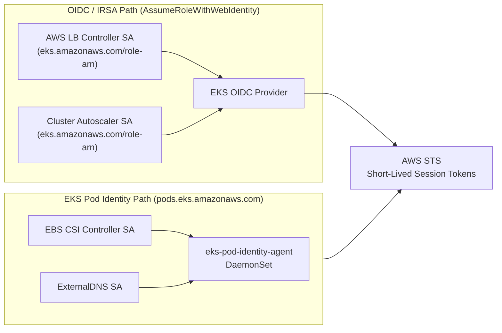

# ADR-0001: Hybrid EKS Workload Identity with IRSA and EKS Pod Identity

- **Status:** Accepted
- **Date:** 2026-11-23
- **Deciders:** DEMETER (`demeter`), MINERVA (`minerva`), APOLLO (`apollo`)
- **Component Scope:** `infra/terraform/iam-irsa-pod-identity.tf`, `k8s/platform/`

---

## Context and Problem Statement

Kubernetes workloads running inside our **Amazon EKS `1.34` (`terraform-cluster`)** control plane require fine-grained, short-lived AWS IAM credentials to interact with AWS APIs:
1. **AWS Load Balancer Controller** must provision Application Load Balancers, Target Groups, and Security Group rules.
2. **Cluster Autoscaler** must adjust desired capacities on the `workers-autoscaler` Auto Scaling Group (`min 0`).
3. **Amazon EBS CSI Driver** must attach and encrypt `gp3` PersistentVolumes using KMS.
4. **ExternalDNS** must upsert Route 53 Alias records for `Gateway` and `HTTPRoute` hostnames.

Static AWS access keys stored in Kubernetes `Secret` objects violate Zero Trust governance, and node-level IAM instance profile permissions violate the principle of least privilege by exposing privileges to every pod scheduled onto a worker node.

AWS currently supports two workload identity mechanisms on EKS:
- **IAM Roles for Service Accounts (IRSA)**: Uses the cluster's OpenID Connect (OIDC) provider and `eks.amazonaws.com/role-arn` ServiceAccount annotations.
- **EKS Pod Identity (`eks-pod-identity-agent`)**: Uses an EKS-native DaemonSet (`169.254.170.23`) and `aws_eks_pod_identity_association` resources without coupling IAM trust policies to cluster-specific OIDC provider URLs.

---

## Decision Outcome

We adopt a **Hybrid Workload Identity Architecture** in `infra/terraform/iam-irsa-pod-identity.tf` that provisions both an OIDC provider (`aws_iam_openid_connect_provider`) and the **`eks-pod-identity-agent`** add-on:

1. **IRSA (`AssumeRoleWithWebIdentity`)** is assigned to:
   - **AWS Load Balancer Controller** (`kube-system:aws-load-balancer-controller`)
   - **Cluster Autoscaler** (`kube-system:cluster-autoscaler`)
2. **EKS Pod Identity (`pods.eks.amazonaws.com`)** is assigned to:
   - **Amazon EBS CSI Driver** (`kube-system:ebs-csi-controller-sa`)
   - **ExternalDNS** (`kube-system:external-dns`)

---

## Rationale & Trade-Offs

### Why Hybrid Instead of Single-Mechanism?
- **Ecosystem Compatibility & Helm Maturity**: Many third-party controllers and upstream Helm charts still expect explicit `eks.amazonaws.com/role-arn` annotations (`IRSA`), whereas AWS-managed EKS add-ons (`aws-ebs-csi-driver`) and modern DNS controllers integrate seamlessly with `aws_eks_pod_identity_association`.
- **Zero Node-Role Privilege Escalation**: Worker node IAM roles (`infra/terraform/eks.tf`) retain only basic EC2/ECR pull permissions, and `http_put_response_hop_limit = 1` with `http_tokens = "required"` (`IMDSv2`) blocks pods from hijacking the EC2 instance metadata credential endpoint.
- **Role Portability**: Roles configured via **EKS Pod Identity** trust the `pods.eks.amazonaws.com` service principal directly rather than hardcoding a single cluster's OIDC thumbprint URL, simplifying multi-cluster disaster recovery.

---

## Consequences

### Positive
- **Strict Blast-Radius Containment**: Each platform add-on receives a dedicated IAM Role scoped exclusively to its required AWS actions (`autoscaling:SetDesiredCapacity`, `route53:ChangeResourceRecordSets`, `ec2:CreateVolume`, or ALB lifecycle APIs).
- **Zero Static Secrets**: No long-lived `AWS_ACCESS_KEY_ID` or `AWS_SECRET_ACCESS_KEY` values exist anywhere in the repository or cluster.
- **Architectural Showcase**: Demonstrates production co-existence of OIDC-backed IRSA and EKS Pod Identity on EKS `1.34`.

### Negative / Mitigations
- **Operational Dual-Path Awareness**: Platform engineers must inspect both `eks.amazonaws.com/role-arn` ServiceAccount annotations and `aws eks list-pod-identity-associations` when debugging IAM permissions. This is mitigated by declarative management in a single Terraform module (`infra/terraform/iam-irsa-pod-identity.tf`).
