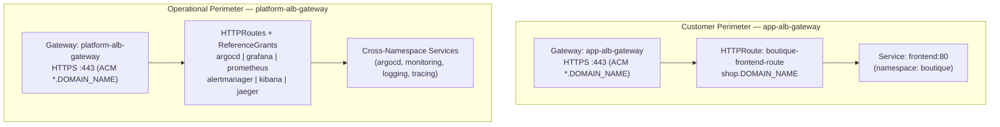

# ADR-0002: Kubernetes Gateway API with Dual-ALB Perimeter Separation

- **Status:** Accepted
- **Date:** 2026-11-23
- **Deciders:** AETHER (`aether`), MINERVA (`minerva`), APOLLO (`apollo`)
- **Component Scope:** `k8s/networking/gateway-api/`

---

## Context and Problem Statement

The Online Boutique platform exposes two fundamentally different classes of HTTP/HTTPS traffic:
1. **Customer Storefront Traffic**: High-volume public e-commerce requests (`shop.${DOMAIN_NAME}`, `${DOMAIN_NAME}`) targeting the `frontend` service in the `boutique` namespace.
2. **Platform Operations & Observability Traffic**: Administrative control planes (`argocd.${DOMAIN_NAME}`, `grafana.${DOMAIN_NAME}`, `prometheus.${DOMAIN_NAME}`, `alertmanager.${DOMAIN_NAME}`, `kibana.${DOMAIN_NAME}`, `jaeger.${DOMAIN_NAME}`) spanning the `argocd`, `monitoring`, `logging`, and `tracing` namespaces.

Traditional Kubernetes `Ingress` (`networking.k8s.io/v1`) suffers from two major limitations:
- Vendor-specific annotations overload a single `Ingress` resource, conflating infrastructure load-balancer provisioning with application team routing rules.
- Sharing a single Application Load Balancer (ALB) across customer storefront traffic and administrative observability UIs creates a shared failure domain and prevents independent WAF, rate-limiting, or IP allowlisting policies.

---

## Decision Outcome

We adopt the **Kubernetes Gateway API (`gateway.networking.k8s.io/v1` and `v1beta1`)** backed by the AWS Load Balancer Controller (`aws.k8s.aws/alb`) and provision **two physically isolated AWS Application Load Balancers**:

1. **`GatewayClass` (`aws-alb-gateway-class`)**: Binds Gateway API resources to `aws.k8s.aws/alb` with `scheme: internet-facing` and `target-type: ip` (direct VPC CNI pod IP routing).
2. **`app-alb-gateway` (`alb.ingress.kubernetes.io/group.name: online-boutique-app`)**:
   - Terminates HTTPS (`:443`) using the Route 53 DNS-validated wildcard ACM certificate (`*.${DOMAIN_NAME}`).
   - Restricts route attachment to `Same` namespace (`boutique`).
   - Bound to `HTTPRoute/boutique-frontend-route` routing `shop.${DOMAIN_NAME}` and `${DOMAIN_NAME}` -> `frontend:80`.
3. **`platform-alb-gateway` (`alb.ingress.kubernetes.io/group.name: online-boutique-platform`)**:
   - Terminates HTTPS (`:443`) on a dedicated operational ALB.
   - Permits cross-namespace route attachment (`from: All`) governed by explicit `ReferenceGrant` (`gateway.networking.k8s.io/v1beta1`) policies in `argocd`, `monitoring`, `logging`, and `tracing`.
   - Routes `argocd`, `grafana`, `prometheus`, `alertmanager`, `kibana`, and `jaeger` subdomains to their respective backend services.

---

## Rationale & Trade-Offs

### Role-Oriented Separation & Zero Trust `ReferenceGrant`
- **Explicit Cross-Namespace Authorization**: Under the Kubernetes Gateway API specification, an `HTTPRoute` in `boutique` cannot forward traffic to a `Service` in `monitoring`, `logging`, `tracing`, or `argocd` unless the target namespace declares a `ReferenceGrant` explicitly authorizing `HTTPRoute` references from `boutique`.
- **Blast-Radius Isolation**: A DDoS spike or misconfiguration on the customer storefront (`app-alb-gateway`) cannot saturate or degrade the operational observability and GitOps recovery planes (`platform-alb-gateway`).
- **Direct Pod IP Target Routing (`target-type: ip`)**: Eliminates an extra kube-proxy NodePort hop, enabling the AWS ALB to load-balance directly to VPC CNI pod ENI IP addresses and honor readiness probes cleanly during rolling deployments.

---

## Consequences

### Positive
- **Future-Proof Kubernetes Standard**: Aligns ingress routing with the upstream Kubernetes Gateway API (`v1`) specification and the reusable `aether-k8s-gateway-api` GAIA skill.
- **Automated DNS Lifecycle**: ExternalDNS watches both `Gateway` and `HTTPRoute` objects and maintains Route 53 Alias records automatically.
- **Independent Perimeter Hardening**: Security teams can attach separate AWS WAFv2 WebACLs or corporate VPN CIDR security group restrictions to `platform-alb-gateway` without impacting public shoppers on `app-alb-gateway`.

### Negative / Mitigations
- **Fixed Hourly Cost of Two ALBs**: Provisioning two AWS ALBs instead of one adds approximately ~$16/month in base AWS ALB fixed cost. This is a deliberate trade-off for production blast-radius isolation between customer traffic and platform control planes.
