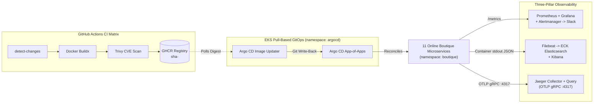

# ADR-0003: GitOps Continuous Delivery with Argo CD Image Updater and Three-Pillar Observability

- **Status:** Accepted
- **Date:** 2026-11-23
- **Deciders:** HEPHAESTUS (`hephaestus`), APOLLO (`apollo`), MINERVA (`minerva`)
- **Component Scope:** `.github/workflows/ci-cd-matrix.yml`, `k8s/argocd/`, `k8s/observability/`

---

## Context and Problem Statement

Operating an 11-microservice polyglot architecture (`Go`, `.NET 8`, `Python 3.12 FastAPI`, `React 18`, `Node.js`, `Java`) in production introduces two critical operational challenges:
1. **CI/CD & Cluster Drift**: Running `kubectl apply` directly from GitHub Actions requires exposing cluster administrative credentials to external CI runners and easily causes configuration drift between Git and the live EKS cluster. Rebuilding all 11 microservices on every commit also wastes CI compute.
2. **Telemetry Blind Spots across Polyglot Services**: When a customer checkout latency spike occurs (`checkoutservice` -> `cartservice` -> `ElastiCache Redis` or `paymentservice`), isolated container logs or CPU metrics alone cannot pinpoint which downstream gRPC/HTTP hop introduced the bottleneck.

---

## Decision Outcome

### 1. Path-Filtered CI Matrix + Pull-Based GitOps (`Argo CD` + `Image Updater`)
- **Selective CI Matrix (`.github/workflows/ci-cd-matrix.yml`)**: A `detect-changes` job inspects changed file paths and triggers parallel Docker Buildx builds, **Trivy** vulnerability scans (`CRITICAL`/`HIGH` gate), and **GHCR** pushes (`ghcr.io/<org>/online-boutique/<service>:sha-<commit>`) **only** for modified microservices.
- **Argo CD App-of-Apps (`k8s/argocd/root-app.yaml`)**: Orchestrates ordered sync waves across `platform-addons`, `gateway-api-perimeter`, `observability-stack`, and `online-boutique-app` with `selfHeal: true` and `prune: true`.
- **Argo CD Image Updater (`k8s/argocd/image-updater-config.yaml`)**: Runs inside the cluster, polls GHCR for newly scanned `sha-*` tags, and performs an automated **Git write-back commit** updating image references without ever granting GitHub Actions write access to the private EKS `1.34` API server.

### 2. Unified Three-Pillar Observability Stack (`k8s/observability/`)
We deploy three specialized telemetry namespaces governed by the `apollo-observability-stack` skill:
1. **Metrics & Slack Alerting (`monitoring`)**:
   - **Prometheus** scrapes node, pod, and application metrics (`15d` retention on encrypted `ebs-gp3-sc` volumes).
   - **Grafana** visualizes golden signals (Request Rate, Error Rate, P99 Latency, Pod Saturation).
   - **Alertmanager** evaluates Prometheus alert rules and dispatches real-time incident notifications to **Slack (`#online-boutique-alerts`)**.
2. **Centralized Log Aggregation (`logging`)**:
   - **Filebeat DaemonSet** tails `/var/log/containers/*.log` on every worker node, enriches records with Kubernetes pod metadata, and ships structured logs to a 3-node **ECK Elasticsearch `8.12.2`** cluster visualized in **Kibana `8.12.2`**.
3. **OpenTelemetry Distributed Tracing (`tracing`)**:
   - **Jaeger (`1.54`)** exposes the native **OTLP gRPC receiver on `:4317`** (`jaeger-collector.tracing.svc.cluster.local:4317`). Every microservice receives `OTEL_EXPORTER_OTLP_ENDPOINT=http://jaeger-collector.tracing.svc.cluster.local:4317` via `boutique-env-config` to trace cross-service calls end-to-end.

---

## Consequences

### Positive
- **Compatible with Private EKS Endpoint**: Because Argo CD and Argo CD Image Updater pull state from inside the VPC (`10.0.0.0/16`), the EKS `1.34` API server remains strictly private (`endpoint_public_access = false`).
- **Auditable Git History**: Every production image promotion is recorded as an immutable Git commit authored by Argo CD Image Updater.
- **Full-Correlation Mean Time to Resolution (MTTR)**: Engineers receiving a Slack alert from Alertmanager can pivot directly from Grafana golden-signal spikes to Kibana pod logs and Jaeger `:4317` OTLP waterfall traces via the `platform-alb-gateway` operational subdomains.

### Negative / Mitigations
- **Stateful Observability Storage Overhead**: Running Prometheus and a 3-node ECK Elasticsearch cluster inside EKS consumes memory and `gp3` EBS storage. This is mitigated via bounded retention windows (`15d` for Prometheus), explicit resource requests/limits, and elastic burst capacity from the `workers-autoscaler` node group.
