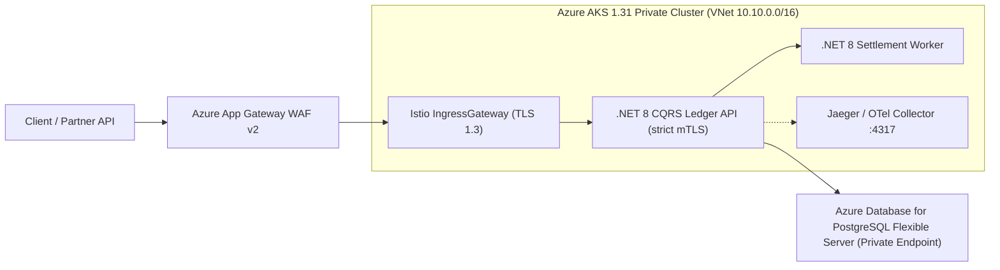

# 🏦 Blueprint 02 — Azure AKS Zero-Trust FinTech Ledger (Starter Reference)

  
  
  
  
  

> **Multi-Cloud Companion Reference demonstrating how the G.A.I.A. 6-Layer Methodology adapts from AWS EKS to Azure AKS with Istio mTLS and PostgreSQL Flyway migrations.**

---

## 1. Architecture Overview

While [**Blueprint 01 (`01-aws-eks-online-boutique-platform`)**](../01-aws-eks-online-boutique-platform/README.md) showcases a complete, production-verified AWS EKS e-commerce platform, **Blueprint 02** provides the Azure AKS architectural reference pattern governed by `demeter-terraform-azure-base`, `aether-istio-ingress`, `eleuthia-net-api-cqrs`, and `poseidon-flyway-migration`.

---

## 2. GAIA Skills Mapped to This Blueprint

- **Layer 1 (DEMETER):** `demeter-terraform-azure-base` (Azure Blob Storage state backend, VNet, Private AKS cluster, Azure PostgreSQL Flexible Server, Entra Workload Identity).
- **Layer 2 (AETHER):** `aether-istio-ingress` (`Gateway`, `VirtualService`, `PeerAuthentication` with `mtls.mode: STRICT`).
- **Layer 3 (ELEUTHIA + POSEIDON):** `eleuthia-net-api-cqrs` + `eleuthia-net-worker` + `poseidon-flyway-migration` (idempotent double-entry ledger schema migrations).
- **Layer 4 (APOLLO):** `apollo-observability-stack` (Prometheus, Grafana, Jaeger OTLP `:4317`).
- **Layer 5 (HEPHAESTUS):** `hephaestus-net-cicd` + `hephaestus-argocd-gitops`.
- **Layer 6 (MINERVA + ARTEMIS + HADES):** `minerva-review`, `artemis-k6-load-test`, `hades-chaos-mesh-experiment`.
